# E1 Tools: guia do usuário

Guia do HUB E1 Tools, o programa que automatiza tarefas nos desenhos 2D do CATIA V5 do programa E1
(EMB170-190). Ele substitui as macros VBA ferramenta por ferramenta e junta tudo numa janela só.

Versão do guia: 20/11/2026, branch `migracao-dwgtools`.

> **Sobre os prints.** Todas as imagens são do HUB de verdade, mas preenchidas com **dados de exemplo**
> (desenho 171-60466-803, Part List e lote do VPM inventados). Os números das telas não são de nenhum
> desenho real. Nas telas do VPM aparece só a prévia, porque o VPM só abre na rede da empresa.

## Sumário

1. [Antes de começar](#1-antes-de-começar)
2. [A janela do HUB](#2-a-janela-do-hub)
3. [Aba Design: ferramentas que alteram o desenho](#3-aba-design-ferramentas-que-alteram-o-desenho)
   - [3.1 Sequência de aplicação](#31-sequência-de-aplicação)
   - [3.2 Update Template](#32-update-template)
   - [3.3 Symbol Shape Converter](#33-symbol-shape-converter)
   - [3.4 Fix Flags](#34-fix-flags)
   - [3.5 Font Size Fix](#35-font-size-fix)
   - [3.6 Pos and Zone Fix](#36-pos-and-zone-fix)
4. [Aba Check: conferências que não alteram o desenho](#4-aba-check-conferências-que-não-alteram-o-desenho)
   - [4.1 Visão geral](#41-visão-geral)
   - [4.2 Font Size Check](#42-font-size-check)
   - [4.3 Position and Zone](#43-position-and-zone)
   - [4.4 Check de Flags](#44-check-de-flags)
   - [4.5 Check de Template](#45-check-de-template)
   - [4.6 Compare DWG](#46-compare-dwg)
5. [Aba Envio: Splits](#5-aba-envio-splits)
   - [5.1 Split 3D](#51-split-3d)
   - [5.2 Split 2D](#52-split-2d)
6. [Aba VPM](#6-aba-vpm)
   - [6.1 O que as três telas têm em comum](#61-o-que-as-três-telas-têm-em-comum)
   - [6.2 Criar PNs](#62-criar-pns)
   - [6.3 Update Content](#63-update-content)
   - [6.4 Criar e atualizar](#64-criar-e-atualizar)
7. [Instalação e atualização](#7-instalação-e-atualização)
8. [Arquivos de diagnóstico e onde ficam](#8-arquivos-de-diagnóstico-e-onde-ficam)
9. [Problemas comuns](#9-problemas-comuns)

---

## 1. Antes de começar

**O que você precisa:**

- CATIA V5 aberto, com o desenho (CATDrawing) ativo. Para o Split 3D, uma peça (CATPart) ativa.
- Excel instalado, para ler o Part List do SAP no Position and Zone e no Check de Flags.
- Microsoft Edge e acesso à rede da empresa, só para a aba VPM.

**Como abrir:** na pasta do programa, rode

```bash
python main_qt.py
```

O HUB pode ser aberto antes ou depois do CATIA. Ele percebe sozinho quando o CATIA abre e qual documento
está ativo, a cada 2 segundos. Desenho aberto pelo VPM também é reconhecido: o HUB olha o tipo do
documento no CATIA, e não só a extensão do nome.

**Três regras que valem para todas as ferramentas:**

1. **Salve uma cópia antes de usar uma ferramenta que altera o desenho.** As ferramentas da aba Design
   mudam o desenho aberto. Nada é salvo pelo HUB: você confere e salva. Se algo sair errado, feche o
   desenho **sem salvar** e abra de novo.
2. **Não mexa no CATIA enquanto o HUB trabalha.** Durante uma execução, o chip no alto mostra
   "CATIA ocupado" e a tela avisa. Clicar no CATIA nesse momento pode atrapalhar o que está sendo feito.
3. **A etiqueta de cada tela diz o que ela faz com o desenho:**

| Etiqueta | Significado |
|---|---|
| ALTERA O DESENHO | Muda o desenho aberto. Confira e salve depois. |
| SÓ CONFERE | Só lê. O desenho não muda. |
| CRIA ARQUIVOS | Grava arquivos novos em outra pasta. O documento aberto não é dividido. |
| Altera o VPM | Cria PNs ou envia arquivos para o VPM. Não dá para desfazer pelo HUB. |

---

## 2. A janela do HUB

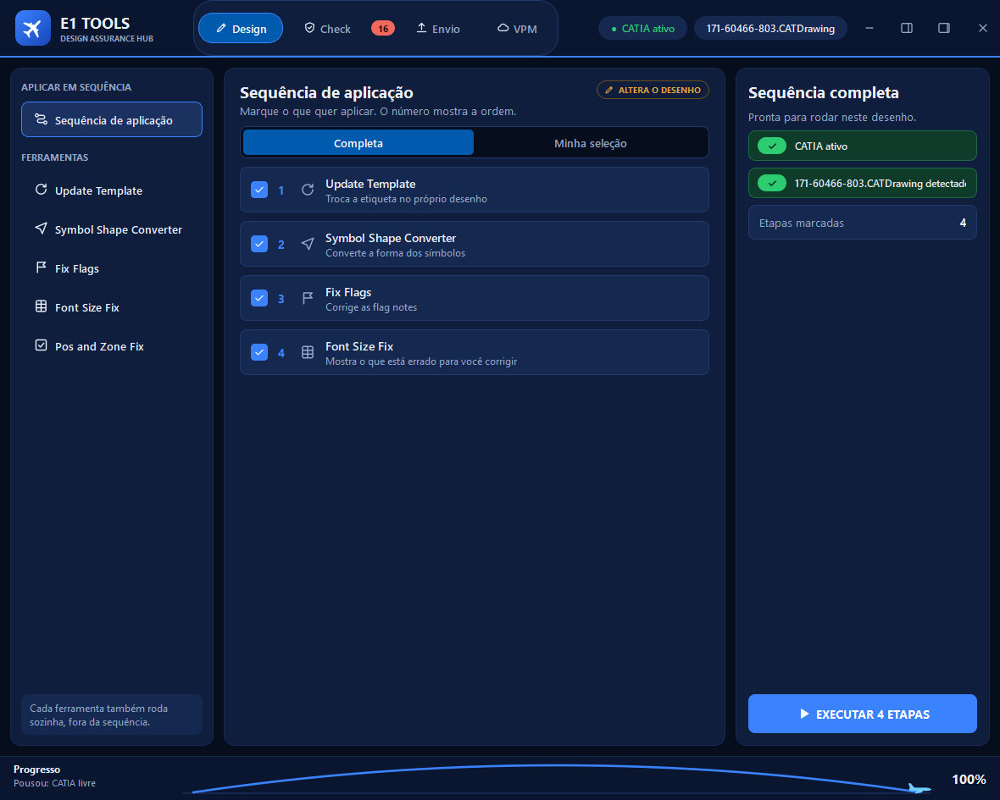

| Parte da tela | Para que serve |
|---|---|
| Abas no alto (Design, Check, Envio, VPM) | Trocam o grupo de ferramentas. O número vermelho ao lado de Check é o total de itens para revisar nos checks desta sessão. |
| Chip "CATIA ativo" | Verde: CATIA aberto e livre. Amarelo "CATIA ocupado": o HUB está trabalhando nele. Vermelho "CATIA fechado": o HUB não achou o CATIA. |
| Chip com o nome do documento | O documento ativo no CATIA. "Nenhum desenho" quando não há. |
| Lista à esquerda | As ferramentas da aba. O número em cada uma é o que ficou para revisar no último resultado. |
| Faixa "Progresso", embaixo | O avião anda conforme a ferramenta avança. "Pousou: CATIA livre" quando termina. |
| Botões no canto direito | Minimizar, modo canto, modo só ícones e fechar. Veja [modos de janela](#modos-de-janela). |

**Sem CATIA ou sem desenho**, cada ferramenta mostra o que falta e um botão PROCURAR DE NOVO. Não é
preciso clicar: o HUB libera a ferramenta assim que o documento certo fica ativo.

| CATIA fechado | Documento ativo não é um desenho |
|---|---|
| 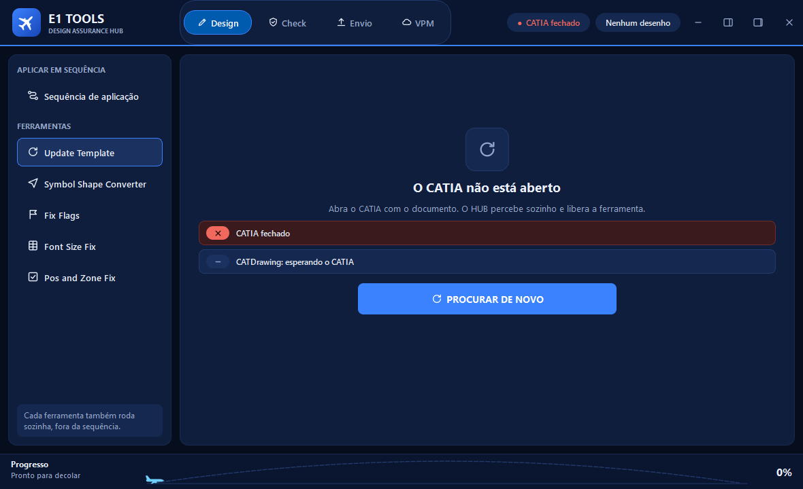 | 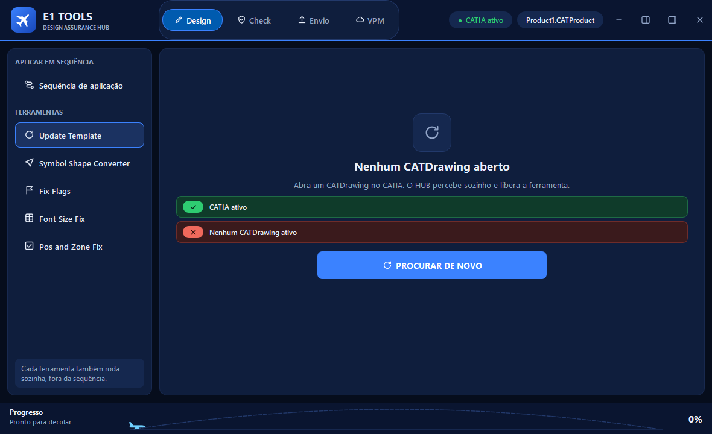 |

**Telas comuns a quase todas as ferramentas:**

- **Início:** explica a ferramenta e tem o botão principal.
- **Em andamento:** barra de progresso, aviso para não mexer no CATIA e, quando a ferramenta permite,
  o botão PARAR. Parar termina o item ou a folha atual e para; o que já foi feito fica feito.
- **Resultado:** lista do que foi encontrado ou feito, com um resumo à direita.
- **Navegação até o item:** nas listas de flags, textos, callouts e folhas, clicar numa linha (ou usar
  ANTERIOR e PRÓXIMO) leva o CATIA até o item, seleciona e enquadra. O estado aparece ao lado:
  "Indo até…" (amarelo), "Selecionado no CATIA" (verde) ou "não encontrado" (vermelho, quando o item foi
  apagado ou o desenho foi fechado). Do último item, PRÓXIMO volta para o primeiro.

### Modos de janela

| Modo | Como entrar | Como fica |
|---|---|---|
| Normal | Padrão ao abrir | Janela de 1180 × 720 com tudo visível. Pode ser arrastada pelo cabeçalho. |
| Canto | Botão com dois painéis, no alto à direita | Coluna estreita na borda direita da tela, sempre por cima do CATIA. As abas e ferramentas viram uma faixa de ícones (D, C, E, V e os ícones de cada ferramenta). As listas mostram só as colunas principais. Clique de novo no mesmo botão para voltar ao normal. |
| Só ícones | Botão com o quadrado, no alto à direita | Uma barra fina no canto da tela, sempre por cima. Clicar no ícone de uma ferramenta abre um cartão com o resumo dela e os botões EXECUTAR e ABRIR NO CANTO. Clicar de novo no mesmo ícone fecha o cartão. Os dois botões no pé da barra vão para o modo canto ou para o normal. |

| Modo canto | Só ícones | Cartão no modo só ícones |
|---|---|---|
| 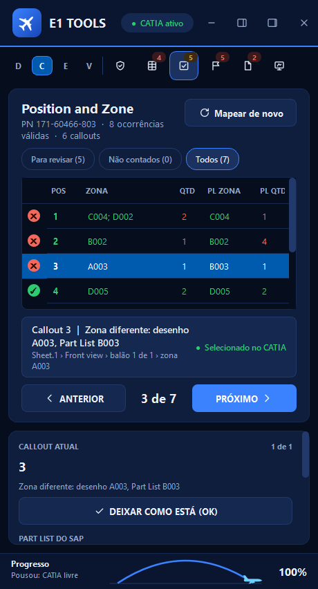 |  | 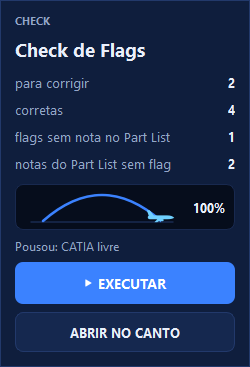 |

O botão EXECUTAR do cartão faz o mesmo que o botão principal da tela da ferramenta.

**Ao fechar o HUB**, ele tira a seleção que deixou no CATIA e religa alertas, tela e interação do CATIA.
Com um lote do VPM rodando, o HUB não fecha: interrompa o lote antes.

---

## 3. Aba Design: ferramentas que alteram o desenho

Todas as ferramentas desta aba **alteram o desenho aberto**. Salve uma cópia antes. Cada uma roda
sozinha ou junto com as outras na Sequência de aplicação.

### 3.1 Sequência de aplicação

**Para que serve:** roda, em ordem e de uma vez, Update Template, Symbol Shape Converter, Fix Flags e a
análise do Font Size Fix.

**Quando usar:** para preparar um desenho inteiro de uma vez, por exemplo depois de trazer um desenho no
template antigo.

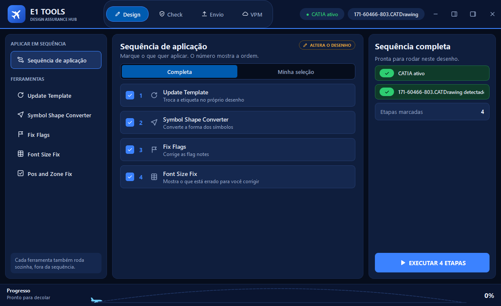

**Passo a passo:**

1. Abra o desenho no CATIA e salve uma cópia.
2. Em **Design › Sequência de aplicação**, escolha **Completa** (as quatro etapas) ou desmarque as que
   não quer (vira **Minha seleção**). O número ao lado de cada etapa mostra a ordem.
3. Confira à direita: "CATIA ativo" e o nome do desenho "detectado" em verde.
4. Clique em **EXECUTAR N ETAPAS**.
5. Acompanhe a linha do tempo. Se precisar, clique em **PARAR DEPOIS DESTA ETAPA**: a etapa atual termina
   e as seguintes não rodam.

| Em andamento | Concluída |
|---|---|
| 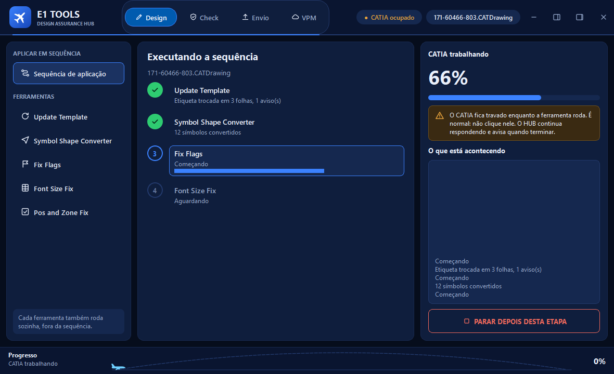 | 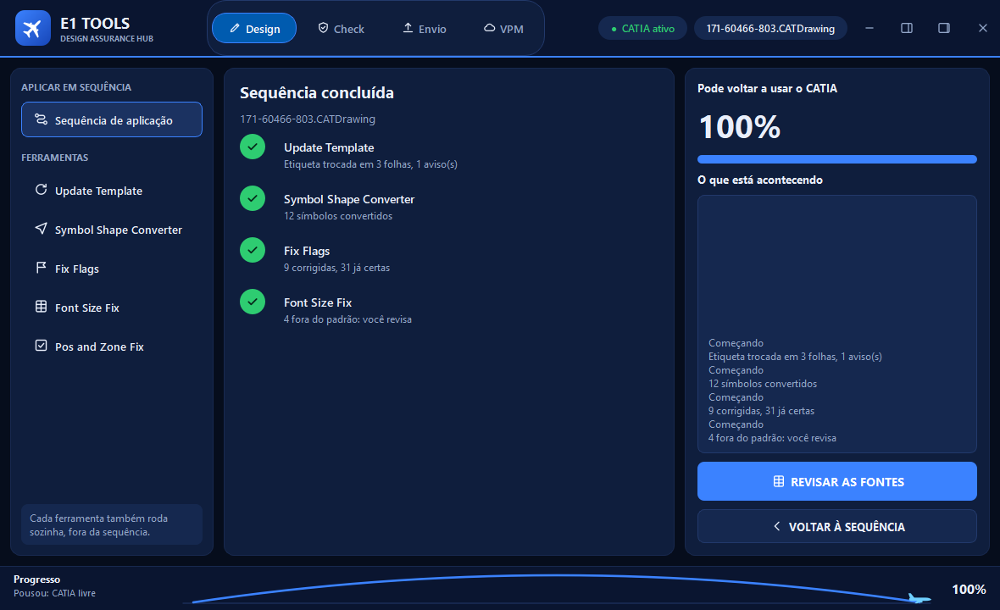 |

**O que cada etapa faz na sequência:**

| Etapa | O que faz |
|---|---|
| Update Template | Troca o template no próprio desenho. Se o formato não for detectado, abre uma janela pedindo o formato. Se você escolheu formatos à mão na tela do Update Template, a sequência usa essa escolha. |
| Symbol Shape Converter | Converte a ponta dos leaders dos textos. |
| Fix Flags | Corrige as flags. Na sequência não pergunta antes: clicar em EXECUTAR já é a confirmação. |
| Font Size Fix | **Não corrige nada sozinho.** Só analisa e deixa a lista pronta para você revisar. |

**Resultados:**

- Cada etapa mostra o resumo do que aconteceu (por exemplo "Etiqueta trocada em 3 folhas, 1 aviso(s)",
  "9 corrigidas, 31 já certas", "4 fora do padrão: você revisa").
- **Sequência concluída:** todas as etapas marcadas rodaram. Com o Font Size Fix na lista, aparece o
  botão **REVISAR AS FONTES**, que abre a tela do Font Size Fix com a lista pronta. Sem ele, aparece
  **CONFERIR NO CHECK**.
- **Sequência parada:** você parou, ou cancelou a janela de formato do Update Template. As etapas que não
  rodaram ficam como "Não rodou: você parou a sequência".
- **A sequência parou por um erro:** a etapa com erro fica com um X e as seguintes não rodam. A mensagem
  do erro aparece em "O que está acontecendo". Confira o desenho antes de continuar; se o erro foi no
  Update Template, leia a mensagem: ela diz se o desenho pode ter ficado parcialmente convertido.

O resultado detalhado de cada etapa também fica na tela da própria ferramenta (Update Template, Symbol
Shape, Fix Flags, Font Size Fix).

### 3.2 Update Template

**Para que serve:** troca o template (formato, legenda, margem e grade de zonas) **no próprio desenho**,
pelo template atual do formato. As vistas do desenho não são tocadas.

**Quando usar:** desenho no template antigo ou com legenda desatualizada.

**O que altera no desenho:**

- apaga o Background antigo e cola o Background do template novo em cada folha;
- apaga as grades de zonas antigas (`ZONE`, `ZONE A0`, `ZONES_A1_SHT1` e parecidas) e cola as do template.
  Uma vista sua com "ZONE" no meio do nome continua intacta;
- nas folhas 2 em diante, os números da margem e os rótulos da grade ganham a dezena da folha (na folha
  2, a coluna 9 vira 29; F6 vira F26);
- refaz os campos da legenda ligados aos parâmetros **do próprio desenho**, sem vínculo com o arquivo do
  template (em Edit › Links não deve aparecer o template);
- numera o campo SHEET/OF: a primeira folha mostra `1/total` e as outras só o próprio número; o
  parâmetro `No_of_Sheets` recebe o total de folhas.

**De onde vêm os templates:** da pasta da rede
`\\nfscad05.sjk.emb\dmuv5\smarteam\b01\v5\DLNames\START_UP\`, arquivos
`E1_DRW_TEMPLATE_<formato>_R00.CATDrawing`. Formatos aceitos: 3A0, A0, A1, A2, A3 e E3.

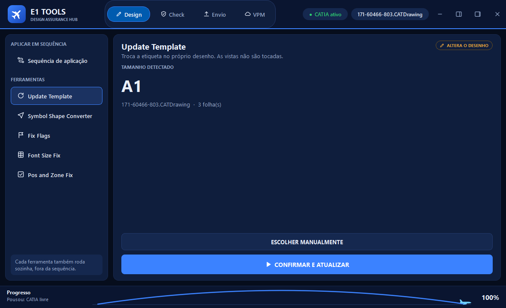

**Passo a passo:**

1. Abra o desenho e salve uma cópia.
2. Em **Design › Update Template**, confira o **TAMANHO DETECTADO**. O HUB lê o formato de cada folha no
   Background, sem alterar nada. Embaixo aparecem o nome do desenho e o número de folhas.
3. Se o tamanho estiver certo, clique em **CONFIRMAR E ATUALIZAR**.
4. Se estiver errado, ou se uma folha tiver outro formato, clique em **ESCOLHER MANUALMENTE**:
   - selecione na tabela a folha (ou as folhas) que quer mudar;
   - clique no formato. Ele vale só para as folhas selecionadas;
   - **USAR O TAMANHO DETECTADO** descarta a escolha manual.
5. Aguarde. A conversão **não pode ser parada no meio**, porque o desenho ficaria parcialmente convertido.
6. Confira o desenho e salve.

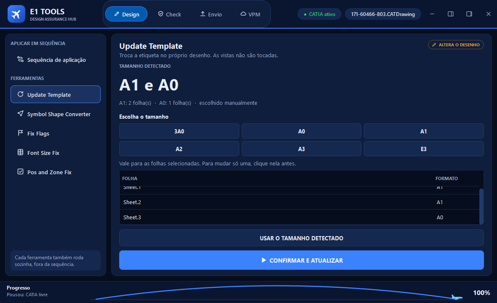

Quando nenhuma folha tem o formato no Background, a escolha manual já abre sozinha. Se o formato da
primeira folha não for achado na hora de converter, o HUB pede numa janela ("Definição de Formato"):
digite 3A0, A0, A1, A2, A3 ou E3. Cancelar essa janela cancela a conversão sem mudar nada.

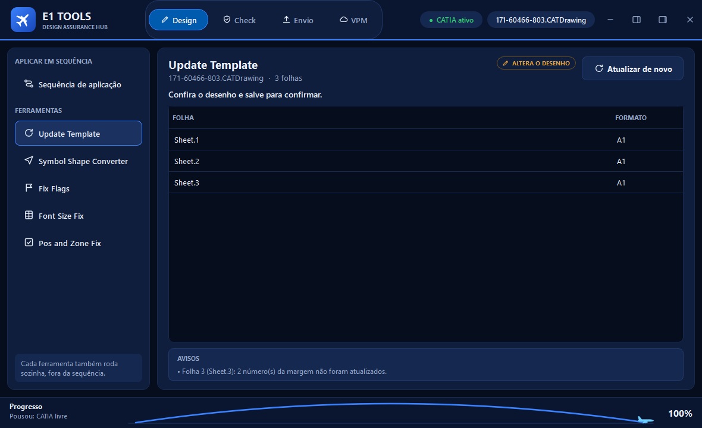

**Resultado:** a lista das folhas com o formato aplicado, a frase "Confira o desenho e salve para
confirmar" e, se houver, os **AVISOS**. Depois da conversão a prévia é lida de novo.

**Avisos que podem aparecer no resultado:**

| Aviso | O que significa |
|---|---|
| Folha N (nome): formato não identificado, usado X. | A folha não tinha formato no Background e recebeu o da primeira folha. Confira se é o certo. |
| Folha N (nome): campo SHEET/OF não encontrado, número não atualizado. | O campo de número de folha não foi achado na legenda dessa folha. Preencha à mão. |
| Folha N (nome): N número(s) da margem não foram atualizados. | Alguns números da margem ficaram sem a dezena da folha. Confira a margem. |
| Folha N: não foi possível numerar a grade X. | A grade de zonas dessa folha ficou sem a dezena. |
| Parâmetro X não existe no desenho: o campo da legenda ficou com o valor do template. | O desenho não tem esse parâmetro. O campo mostra o valor do template. |
| Folha N: o campo ligado a X não foi achado depois de colar… | Um campo da legenda não foi refeito e pode ter ficado ligado ao template. Confira em Edit › Links. |
| Nenhum texto do template está ligado a No_of_Sheets… | A numeração das folhas não foi atualizada. |
| Numeração da margem não encontrada no template… | As margens ficaram sem a dezena da folha. |
| Parâmetro No_of_Sheets não encontrado ou não editável. | O total de folhas não foi gravado no parâmetro. |

**Mensagens de erro (a conversão não acontece ou para):**

| Mensagem | O que fazer |
|---|---|
| Pasta dos templates inacessível / Não foi possível ler a pasta dos templates | A rede está fora ou a pasta mudou. A mensagem mostra a pasta pesquisada. |
| Template não encontrado para o formato X | Não há template desse formato na pasta. Escolha outro formato ou avise quem mantém os templates. |
| O template já está aberto… Feche-o sem salvar e execute novamente. | O template está aberto numa janela do CATIA. Feche sem salvar. Se ele estiver carregado sem janela (depois de uma conversão anterior), isso é normal e não bloqueia. |
| Falha na execução… "O desenho pode ter ficado parcialmente convertido. Feche-o SEM SALVAR e abra novamente" | O erro aconteceu no meio da troca. Não salve: feche, abra de novo e repita. |
| Formato inválido | O formato digitado na janela não é um dos aceitos. |

**Cuidados:**

- Os dittos e as tabelas de um template podem continuar ligados a ele. Se a legenda do seu template
  usar tabela ou ditto, confira em Edit › Links depois de converter.
- O arquivo `update_vinculos.txt` (veja a [seção 8](#8-arquivos-de-diagnóstico-e-onde-ficam)) mostra
  o que cada campo da legenda achou na última conversão.

### 3.3 Symbol Shape Converter

**Para que serve:** troca a ponta dos leaders dos textos pelo símbolo cheio: círculo transparente,
círculo vazado e onda viram círculo cheio; seta vazada vira seta cheia.

**Quando usar:** depois do Update Template, para deixar os símbolos no padrão. Na sequência ele já roda
nessa ordem.

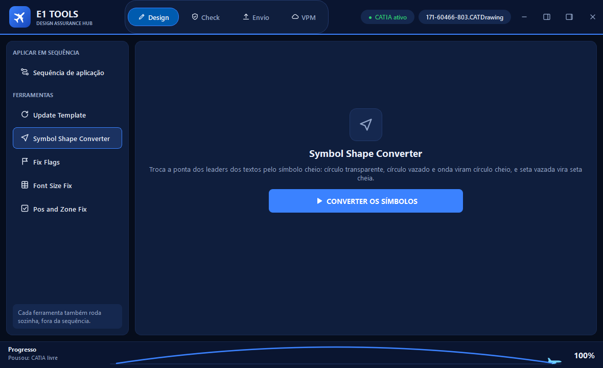

**Passo a passo:**

1. Abra o desenho e salve uma cópia.
2. Em **Design › Symbol Shape Converter**, clique em **CONVERTER OS SÍMBOLOS**.
3. A conversão roda no desenho inteiro de uma vez e não tem botão de parar.

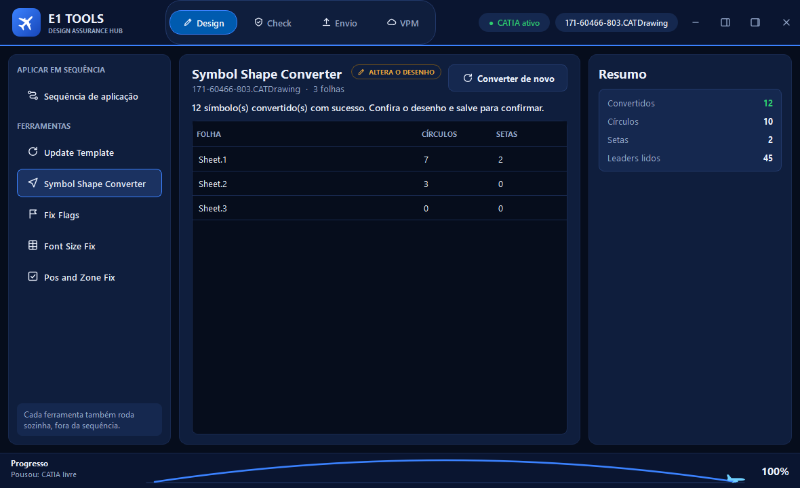

**Resultado:**

- tabela por folha com quantos **círculos** e **setas** foram convertidos;
- resumo: convertidos, círculos, setas e **leaders lidos** (todos os leaders de texto conferidos);
- "N símbolo(s) convertido(s) com sucesso. Confira o desenho e salve para confirmar.";
- "Nenhum símbolo passível de conversão foi encontrado. O desenho não foi alterado." quando não havia
  nada para trocar.

### 3.4 Fix Flags

**Para que serve:** corrige o código das flag notes para o padrão de letras e quatro números, por exemplo
**NL006 vira NL0006** e "NI 12" vira NI0012.

**Quando usar:** sempre que o Check de Flags apontar flags fora do padrão, ou antes de liberar o desenho.

**Flags reconhecidas:** Right Flag, Left Flag, Both Flag, flags fixas com cadeado e flags aplicadas pelo
Text Editor (também quando só parte do texto tem a flag).

**O que altera e o que não altera:**

- só o texto das flags fora do padrão. O tipo da flag é mantido;
- flag já correta não é tocada: nem texto, nem moldura, nem cor;
- nenhum espaço é acrescentado. Tirar um espaço de fora de um código já com quatro números conta como
  correção;
- a flag **não é pintada** de verde ou vermelho: o resultado fica só na tela;
- se o texto tinha largura de quebra fixa, ela é ajustada para o código não partir em duas linhas;
- texto com letras de cores misturadas fica com a cor da primeira letra depois de regravado (é do CATIA).

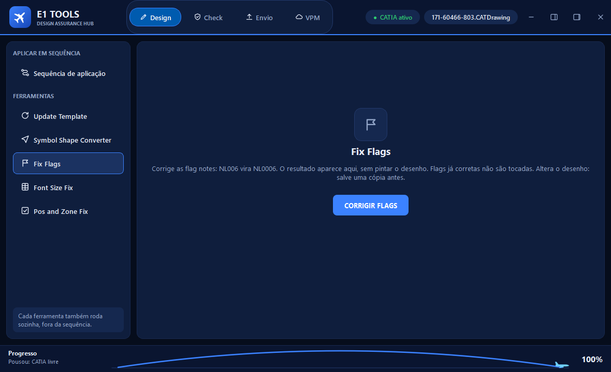

**Passo a passo:**

1. Abra o desenho e salve uma cópia.
2. Em **Design › Fix Flags**, clique em **CORRIGIR FLAGS**. Não abre janela de confirmação: o clique já
   é a confirmação.
3. Acompanhe "Folha N de M". **PARAR** termina a folha atual e para.
4. No resultado, percorra a lista. Clique numa linha ou use ANTERIOR/PRÓXIMO para ir até a flag no
   CATIA; a navegação enquadra a flag junto com a ponta da seta.
5. Confira e salve. **CONFERIR NO CHECK** leva à Visão geral do Check.

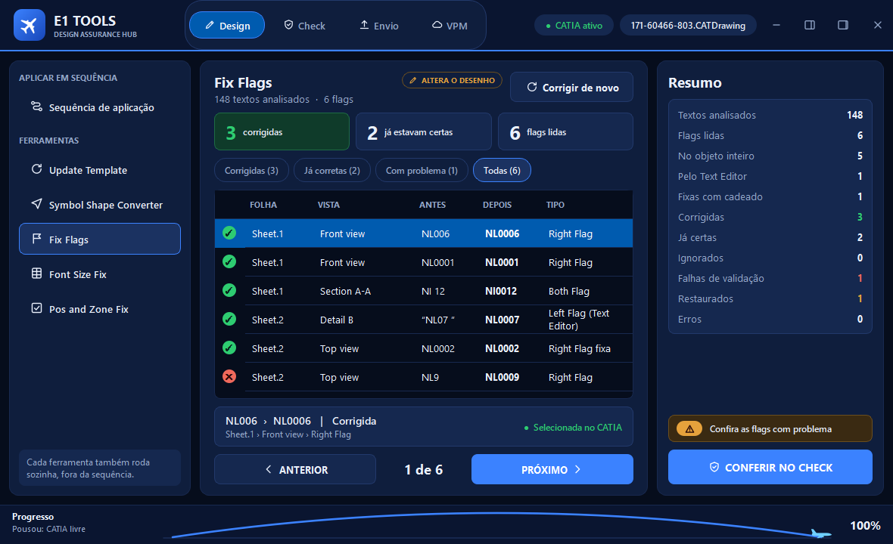

**Resultado:**

- cartões: **corrigidas**, **já estavam certas** e **flags lidas**;
- filtros: Corrigidas, Já corretas, Com problema e Todas. A tela abre no que pede atenção primeiro;
- colunas: folha, vista, texto **ANTES**, texto **DEPOIS** e **TIPO** da flag (com "(Text Editor)"
  quando aplicada por ele, e "fixa" quando tem cadeado).

**Resultado de cada flag:**

| Resultado | Significado |
|---|---|
| Corrigida | O código foi trocado e conferido. |
| Já correta | Já estava no padrão. Não foi tocada. |
| Falhou, texto restaurado | A troca falhou e o texto voltou a ser o que era. Corrija à mão. |
| Falhou, não restaurada | A troca falhou e o texto **não** pôde voltar. Confira essa flag no CATIA. |
| Erro | O CATIA recusou a leitura ou a gravação dessa flag. |

**Resumo à direita:** textos analisados, flags lidas, no objeto inteiro, pelo Text Editor, fixas com
cadeado, corrigidas, já certas, **ignorados** (texto com flag que não tem um código de letras e números,
e por isso fica como está), **falhas de validação** (a releitura não bateu com o esperado),
**restaurados** e **erros**. Embaixo: "Pode voltar a usar o CATIA" ou "Confira as flags com problema".

**Se der erro no meio:** aparece "O fix foi interrompido", com o número e a descrição do erro, e "O que
aparece abaixo já foi alterado no desenho". A lista mostra o que já foi mudado até ali.

### 3.5 Font Size Fix

**Para que serve:** mostra os textos com tamanho fora do padrão da folha e corrige **um por um**, com a
sua confirmação. Muda só o tamanho.

**Quando usar:** quando o Font Size Check aponta textos fora do padrão, ou no fim da Sequência de
aplicação (botão REVISAR AS FONTES).

**Padrão de tamanho por formato** (o formato é lido no Background de cada folha):

| Formato | Tamanhos aceitos |
|---|---|
| A0, E0, E3, 3A0 | 0,197" e 0,277" |
| A1, A3 | 0,17" e 0,25" |
| A2 | 0,108" e 0,193" |
| A4 | 0,07" e 0,125" |

**O que fica de fora:** Main View, Background, a grade de zonas do template, vistas ocultas e itens
ocultos. Cotas não são conferidas no CATIA V5R20, que não informa o tamanho da cota; se uma cota
aparecer, a situação dela é "Cota: corrija no CATIA". Vista travada é destravada só durante a troca e
travada de novo, mesmo se a troca falhar.

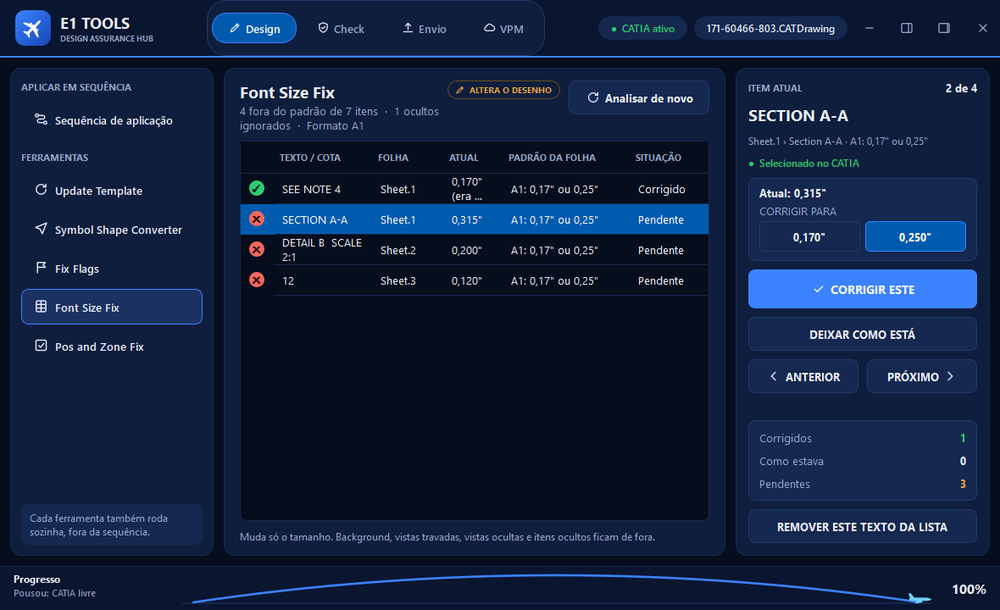

**Passo a passo:**

1. Abra o desenho e salve uma cópia.
2. Em **Design › Font Size Fix**, clique em **ANALISAR AS FONTES**. Se o formato não estiver no
   Background de nenhuma folha, o HUB pede o formato numa janela.
3. A lista mostra cada texto fora do padrão: texto, folha, tamanho **ATUAL**, **PADRÃO DA FOLHA** e
   **SITUAÇÃO**. Ao escolher uma linha, o CATIA vai até o texto.
4. No painel **ITEM ATUAL**, em **CORRIGIR PARA**, já vem marcado o padrão mais perto do tamanho atual.
   Troque se quiser o outro.
5. Clique em **CORRIGIR ESTE**. O HUB troca o tamanho, lê de volta e passa ao próximo.
6. Para manter um texto como está, clique em **DEIXAR COMO ESTÁ**.
7. **REMOVER ESTE TEXTO DA LISTA** tira da lista um texto que não precisa ser conferido, sem alterar o
   desenho. Ele volta na próxima análise.
8. Salve o desenho.

**Situação de cada texto:**

| Situação | Significado |
|---|---|
| Pendente | Ainda não decidido. |
| Corrigido | Tamanho trocado e conferido. A coluna ATUAL mostra o novo e "(era …)". |
| Como estava | Você escolheu deixar como está. Ainda dá para corrigir depois. |
| Falhou | O CATIA não aceitou o tamanho (por exemplo "O CATIA não aceitou o tamanho: ficou X"). Tente de novo ou corrija à mão. |
| Cota: corrija no CATIA | Cotas não são corrigidas pelo HUB. |

O resumo embaixo conta Corrigidos, Como estava e Pendentes. O texto no alto informa quantos itens
ocultos foram ignorados e quantos você removeu da lista.

### 3.6 Pos and Zone Fix

**Para que serve:** é a mesma tabela do [Position and Zone](#43-position-and-zone) (aba Check), com um
recurso a mais: **mover o balão para a zona certa**.

**Quando usar:** quando o Position and Zone aponta zona diferente entre o desenho e o Part List.

**Por que mover:** a zona de um callout vem do lugar do balão na folha. Corrigir a zona é mover o balão.

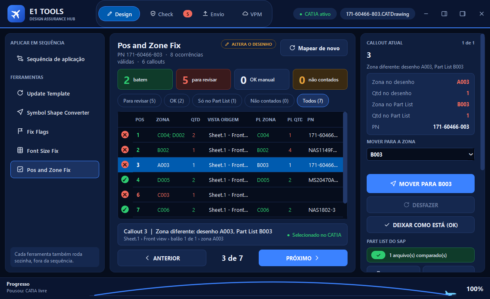

**Passo a passo:**

1. Salve uma cópia do desenho.
2. Em **Design › Pos and Zone Fix**, clique em **MAPEAR CALLOUTS** (ou use o mapeamento já feito no
   Check: as duas telas mostram a mesma leitura) e carregue o Part List (veja a
   [seção 4.3](#43-position-and-zone)).
3. Escolha a linha com zona diferente. O CATIA vai até o balão.
4. Em **MOVER PARA A ZONA**, o HUB já sugere a zona pedida pelo Part List, se ela existir nesta folha.
   Embaixo aparece **Anda junto:** com os textos encostados no balão (flag, número, quantidade), que se
   movem com ele.
5. Clique em **MOVER PARA (zona)**. O balão vai para o ponto da zona pedida mais perto de onde está. A
   ponta do leader não sai do lugar. O HUB lê a posição de volta para conferir.
6. Olhe o balão selecionado no CATIA. **O HUB não verifica se o novo lugar ficou em cima de outro
   desenho:** quem confere é você.
7. Se não gostou, clique em **DESFAZER** (desfaz os movimentos em ordem, do último para o primeiro).
8. Salve o desenho.

**Quando o botão de mover fica desligado ou recusa:**

| Situação | Mensagem |
|---|---|
| O número é sublinhado, não balão | "Só o balão define a zona: este número é sublinhado." |
| A folha não tem grade de zonas lida | "Esta folha não tem zonas mapeadas." |
| O Part List pede zona de outra folha | "O Part List pede X, que não é desta folha." |
| O balão já está na zona escolhida | "O balão já está na zona X." |
| O CATIA não informou a posição da vista | "Não dá para mover por zona." |
| Depois de mover, a zona lida não bateu | "O balão ficou na zona X, e não na Y. Voltei para onde estava." |
| A leitura ficou velha (desenho mudou) | "O balão não está mais na leitura do desenho. Mapeie de novo." |
| Vista travada | Não move. Destrave a vista no CATIA se precisar mover. |

Se a posição já bate em outro balão do mesmo número, o HUB não sugere mover os outros: eles só mostram
onde a peça aparece. **CONFERIR NO CHECK** volta para a tela do Check com a tabela atualizada.

---

## 4. Aba Check: conferências que não alteram o desenho

Nada nesta aba altera o desenho. As conferências só leem, e a navegação só seleciona e enquadra.

### 4.1 Visão geral

**Para que serve:** roda vários checks de uma vez e mostra o resultado de cada um nesta sessão.

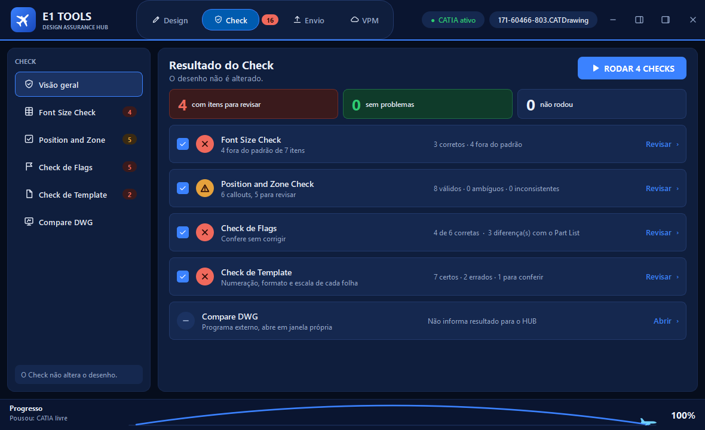

**Passo a passo:**

1. Marque os checks que quer rodar (Font Size Check, Position and Zone, Check de Flags, Check de
   Template).
2. Clique em **RODAR N CHECKS**. Eles rodam um depois do outro.
3. Em cada linha, **Revisar ›** abre a tela do check com a lista.

**O que cada cor significa:**

| Marca | Significado |
|---|---|
| Verde (✓) | Sem problemas. |
| Vermelho (✕) | Tem itens para corrigir. |
| Amarelo (!) | Tem itens para conferir. No Position and Zone, aparece também quando falta carregar o Part List: "Sem Part List: zona e quantidade não foram comparadas". |
| Cinza (–) | Ainda não rodou nesta sessão. |

Os cartões no alto contam quantos checks têm itens para revisar, quantos estão sem problemas e quantos
não rodaram. Nada aqui é estimado: só aparece o que de fato rodou. O **Compare DWG** é um programa à
parte e não informa resultado para o HUB; **Abrir ›** só o abre.

### 4.2 Font Size Check

**Para que serve:** confere o tamanho de todos os textos pelo formato de cada folha. Usa as mesmas
regras do [Font Size Fix](#35-font-size-fix), sem alterar nada.

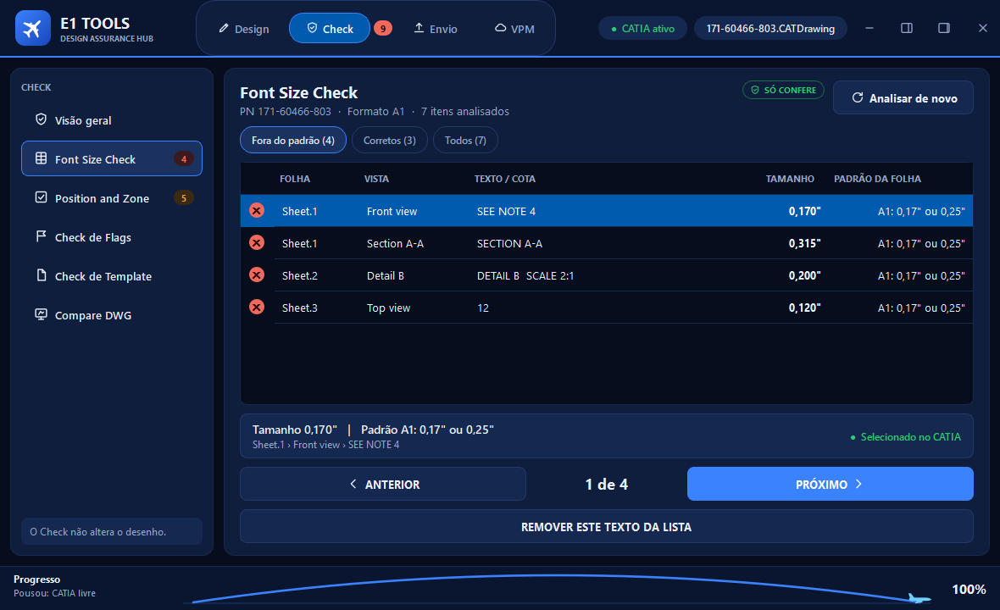

**Passo a passo:**

1. Em **Check › Font Size Check**, clique em **ANALISAR**.
2. Se o formato não estiver no Background de nenhuma folha, digite o formato pedido (A0, A1, A2, A3,
   A4, E0, E3 ou 3A0).
3. A lista abre em **Fora do padrão**. Os filtros **Corretos** e **Todos** mostram o resto.
4. Clique em cada linha (ou ANTERIOR/PRÓXIMO) para ir até o texto no CATIA. O zoom é de 8 vezes o da
   folha inteira.
5. **REMOVER ESTE TEXTO DA LISTA** tira um texto que não precisa ser conferido, sem alterar o desenho.

**Resultado:** PN, formato, itens analisados; para cada item a folha, a vista, o texto, o **TAMANHO**
em polegadas e o **PADRÃO DA FOLHA**. Itens ocultos fora do padrão não entram na lista; o total
ignorado aparece no Font Size Fix. Sem nada fora do padrão, a tela diz "Nenhum item fora do padrão" e
mostra os padrões usados.

Para corrigir, use o [Font Size Fix](#35-font-size-fix).

### 4.3 Position and Zone

**Para que serve:** acha os callouts (balões de posição) de todas as folhas, calcula a zona e a
quantidade de cada um e compara com o **Part List do SAP**. Só confere.

**Quando usar:** antes de liberar o desenho, para garantir que posição, zona e quantidade batem com o
Part List.

| Logo depois de mapear, sem Part List | Com o Part List carregado |
|---|---|
| 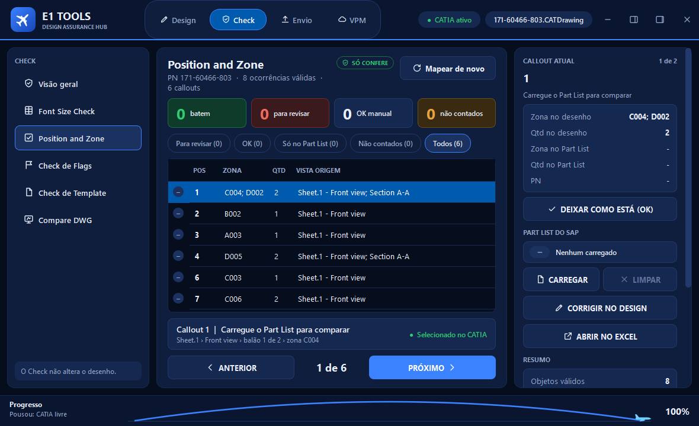 | 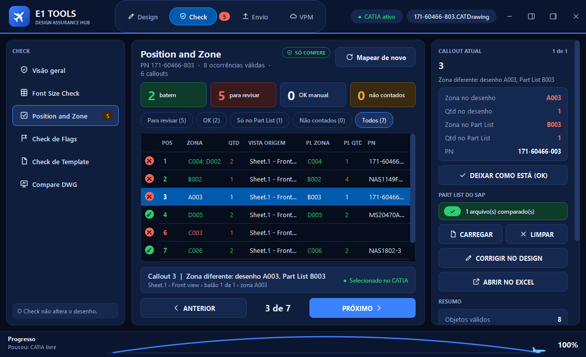 |

**Passo a passo:**

1. Em **Check › Position and Zone**, clique em **MAPEAR CALLOUTS**. O HUB lê todas as folhas (não tem
   botão de parar: sem todas as folhas, as quantidades somadas ficariam erradas).
2. Se aparecer uma janela de aviso no fim, leia: ela lista o que pode ter deixado uma zona errada ou
   vazia (veja a tabela de avisos abaixo).
3. Em **PART LIST DO SAP**, clique em **CARREGAR** e escolha **um ou dois** arquivos Excel extraídos do
   SAP. O HUB abre um Excel escondido, lê e fecha.
4. Use os filtros: **Para revisar**, **OK**, **Só no Part List**, **Não contados** e **Todos**.
5. Clique em cada linha para ir até o balão no CATIA. As setas passam por **todos os balões** de cada
   posição. Duplo clique na linha já escolhida alterna entre os balões da mesma posição.
6. Para um item que o programa não soube confirmar e que você conferiu, clique em **DEIXAR COMO ESTÁ
   (OK)**. Clique de novo (TIRAR O OK) para desfazer.
7. Para corrigir a zona, **CORRIGIR NO DESIGN** abre o [Pos and Zone Fix](#36-pos-and-zone-fix).
8. **ABRIR NO EXCEL** gera a planilha de Callouts como a macro fazia, para quem ainda quiser o Excel.

**O Part List do SAP:**

- arquivo Excel (.xlsx, .xlsm ou .xls) com a aba **COMPONENT** ou **PSA**;
- dados a partir da linha 5: PN na coluna B, posição na M, zona na N, quantidade na T (efetividade nas
  colunas O, R e S);
- com dois arquivos, os dois são somados;
- o mesmo Part List vale para o Check de Flags (aba DWG_NOTES): importar numa tela vale para as duas;
- ao mapear outro desenho (outro PN), o Part List carregado é descartado, para não comparar com o
  desenho errado;
- **LIMPAR** pergunta "Deseja limpar os dados importados do SAP?" e tira só o Part List: a leitura do
  desenho continua.

**Colunas da tabela:**

| Coluna | Conteúdo |
|---|---|
| Marca | Verde: bate. Vermelho: para revisar. Ciano: OK manual. Cinza: sem Part List para comparar. |
| POS | Número da posição. Vermelho se não está no Part List. |
| ZONA | Zona do balão no desenho. Com mais de um balão, todas as zonas (`C004; D002`). |
| QTD | Quantidade somada no desenho. |
| VISTA ORIGEM | Folha e vista do balão. |
| PL ZONA / PL QTD / PN | O que o Part List diz para essa posição. Só aparecem com o Part List carregado. |

Verde ou vermelho em cada célula mostra o que bate e o que não bate.

**Situação de cada linha** (aparece embaixo da tabela e no painel do callout):

| Situação | Significado |
|---|---|
| Posição, zona e quantidade batem com o Part List | Tudo certo. |
| Zona diferente: desenho X, Part List Y | O balão está em outra zona. Com mais de uma zona, no desenho ou no SAP, basta uma bater para ficar verde. |
| Quantidade diferente: desenho X, Part List Y | A soma das quantidades do desenho não bate. |
| Não está no Part List | O balão existe no desenho e a posição não existe no Part List. |
| Está no Part List e não tem balão no desenho | Filtro "Só no Part List". Não tem para onde navegar. |
| (motivo), não contabilizado | Filtro "Não contados": texto ambíguo (grupo de balões) ou com moldura inconsistente, que ficou fora da conta. Confira à mão. |
| Carregue o Part List para comparar | Ainda sem Part List. |
| OK manual, por (usuário) no (Check ou Design) | Você marcou OK. |

**Como a zona e a quantidade são calculadas** (para entender um resultado estranho):

- a grade de zonas sai dos rótulos da margem da folha: a mesma letra dos dois lados, na mesma altura, e
  o mesmo número em cima e embaixo, na mesma coluna. Se a margem não fechar, a grade desenhada do
  template (`ZONES_A1_SHT1` e parecidas) serve de reserva;
- as colunas são numeradas da direita para a esquerda e as linhas de baixo para cima. Nas folhas 2 em
  diante a coluna ganha a dezena da folha (C004 vira C024);
- a zona do balão é a do centro de zona mais próximo;
- a zona vem do **balão** (número com círculo). Número sublinhado só conta a quantidade;
- callout com **REF** perto é ignorado;
- quantidade escrita ao lado, na mesma linha (por exemplo `2 PL`, `4 PLACES`, `2 REQD`), entra na
  conta. Quantidades indicadas por chave também são reconhecidas.

**Avisos no fim do mapeamento:**

| Aviso | O que fazer |
|---|---|
| O CATIA não informou a posição destas vistas. Os callouts delas ficaram sem zona (N/A) | Os callouts dessas vistas aparecem com zona N/A. Confira à mão. A causa ainda não é conhecida. |
| O CATIA não informou a posição destes callouts… | Idem, para callouts soltos. |
| Não achei a grade de zonas destas folhas… | A folha não tem margem nem grade reconhecível. Os balões ficaram sem zona. |
| Nestas folhas a margem não fechou nos dois lados e a zona saiu por um caminho de reserva. Confira um balão de cada | A zona provavelmente está certa, mas confira um balão de cada folha citada. |
| Há folhas com o mesmo nome… | Renomeie as folhas para navegar e mover sem confusão. |

Todos esses avisos terminam com o caminho do arquivo `poszone_grade.txt`, que mostra de onde saiu a grade
de cada folha e a posição de cada balão (veja a [seção 8](#8-arquivos-de-diagnóstico-e-onde-ficam)).

**O OK manual:**

- vale por posição e fica guardado **neste PC**, separado por desenho. Não vai junto com o desenho para
  o PC de outra pessoa;
- deixa de valer sozinho se a zona ou a quantidade mudarem, no desenho ou no Part List.

### 4.4 Check de Flags

**Para que serve:** confere se as flag notes estão no padrão (como NL0006), com as mesmas regras do
[Fix Flags](#34-fix-flags), e compara os códigos com a aba **DWG_NOTES** do Part List do SAP. Não altera
nada.

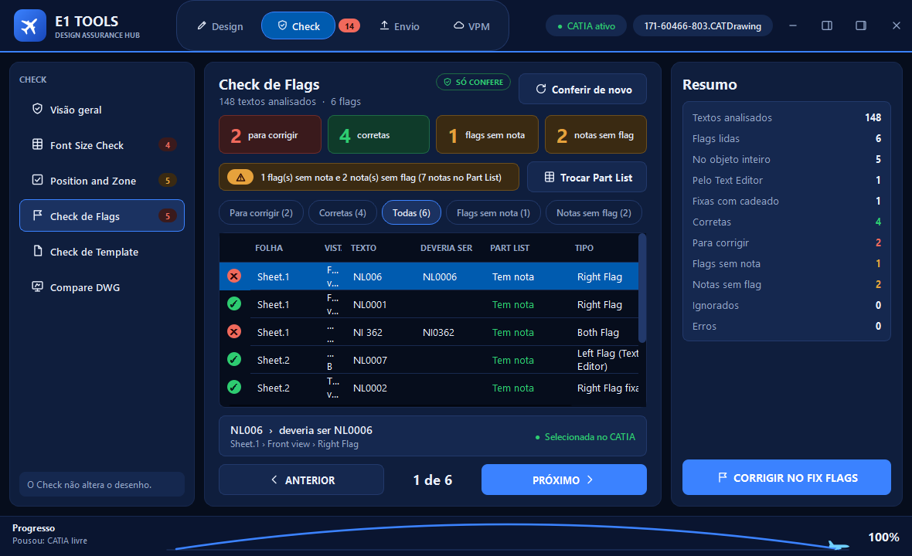

**Passo a passo:**

1. Em **Check › Check de Flags**, clique em **CONFERIR AS FLAGS**.
2. Para comparar com o Part List, clique em **Importar Part List** (ou importe no Position and Zone: o
   arquivo é o mesmo e vale para as duas telas).
3. Use os filtros: **Para corrigir**, **Corretas**, **Todas**, **Flags sem nota** e **Notas sem flag**
   (os dois últimos só aparecem com o Part List carregado).
4. Clique em cada linha para ir até a flag no CATIA.
5. Para corrigir os códigos fora do padrão, **CORRIGIR NO FIX FLAGS** abre o Fix Flags.

**Cartões e colunas:**

- **para corrigir**: flags fora do padrão. A coluna DEVERIA SER mostra o código certo;
- **corretas**: flags no padrão;
- **flags sem nota**: código que está no desenho e não está na DWG_NOTES;
- **notas sem flag**: código da DWG_NOTES que não aparece em nenhuma flag do desenho;
- coluna **PART LIST**: "Tem nota" (verde) ou "Sem nota" (amarelo). Sem Part List, o cartão mostra "-".

**Comparação com o Part List (aba DWG_NOTES):**

- vale a coluna **Note Code** da aba DWG_NOTES; entram todos os códigos, NI e NL;
- o código é comparado no padrão da flag, com quatro números: NL006 no desenho ou na planilha vale
  NL0006. Uma flag fora do padrão conta pelo código certo;
- descrição longa cortada em várias linhas com o mesmo código conta uma vez só.

O filtro **Flags sem nota** mostra as flags do desenho cujo código não está na DWG_NOTES. A coluna PART LIST
fica "Sem nota" e, ao clicar na linha, o CATIA vai até a flag. A flag pode estar no padrão (aqui NL0005 está
correta) e mesmo assim não ter nota: ou a nota falta no Part List, ou o código da flag está trocado.

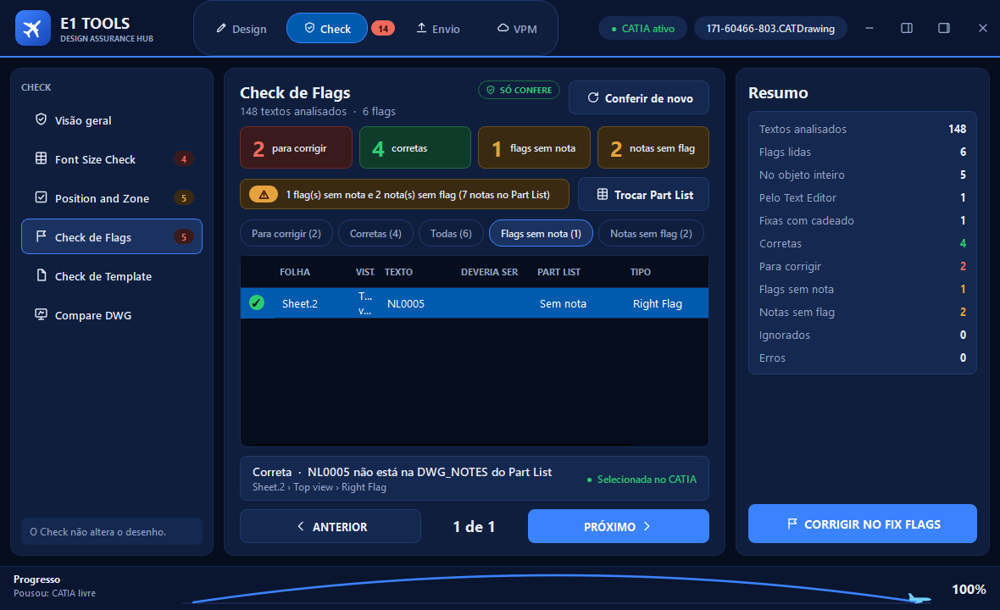

**Linha de situação do Part List:**

| Mensagem | Significado |
|---|---|
| Sem Part List: importe aqui ou no Position and Zone para comparar com a DWG_NOTES | Nada foi comparado ainda. |
| O Part List não tem a aba DWG_NOTES com a coluna Note Code: flags não comparadas | O arquivo serve para o Position and Zone, mas não tem as notas. |
| N notas no Part List: confira as flags para comparar | O Part List foi lido; falta rodar a conferência. |
| N flag(s) sem nota e N nota(s) sem flag | Há diferenças. Use os dois filtros. |
| Desenho e Part List batem: N notas, todas com flag | Tudo certo. |
| … Leitura parada antes do fim: pode faltar flag | A conferência foi parada; a lista de "notas sem flag" pode ter falsos positivos. |

O filtro **Notas sem flag** faz o caminho contrário: códigos da DWG_NOTES que não aparecem em nenhuma flag.

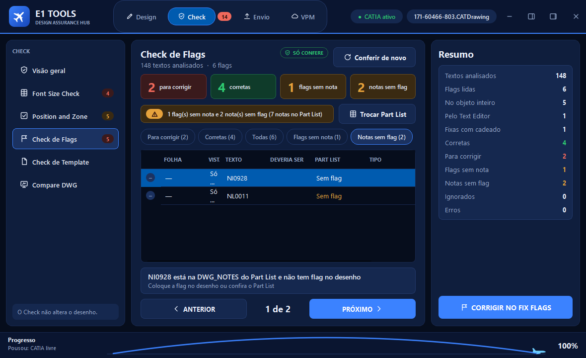

Uma **nota sem flag** não tem lugar no desenho: aparece como "Só no Part List", sem navegação. A tela
sugere "Coloque a flag no desenho ou confira o Part List".

As diferenças com o Part List (flags sem nota e notas sem flag) entram no contador do Check de Flags e
na Visão geral, junto com as flags para corrigir.

### 4.5 Check de Template

**Para que serve:** confere a legenda de cada folha: numeração, formato e escala. Só lê: não ativa
folha, não seleciona e não escreve no desenho.

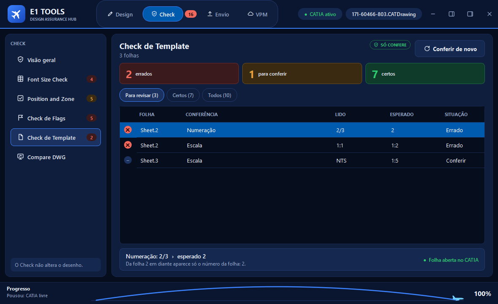

**Passo a passo:**

1. Em **Check › Check de Template**, clique em **CONFERIR O TEMPLATE**.
2. A lista abre em **Para revisar** (errados e para conferir). **Certos** e **Todos** mostram o resto.
3. Clique numa linha para abrir a folha no CATIA. Embaixo aparece a explicação do item.

**O que é conferido:**

| Conferência | Regra |
|---|---|
| Numeração | Campo SHEET/OF: a primeira folha mostra `1/total`; as outras, só o próprio número. |
| Total de folhas | O parâmetro `No_of_Sheets`, se existir, precisa ser igual ao número de folhas. |
| Formato | A etiqueta do formato precisa bater com o tamanho do papel. 3A0 e E3 são papel personalizado, sem medida de referência: ficam em Conferir. |
| Escala | O campo SCALE é comparado com as vistas da folha. Todas batem: Certo. Nenhuma bate: Errado. Só parte bate: Conferir. |

Na escala, não contam as vistas com ISOMETRIC, ISO, SECTION ou VIEW no nome, nem as grades de zona. A
exceção é VIEW LOOKING (FWD, AFT etc.), que conta. PLAN VIEW fica fora. O nome do desenho não é
conferido.

Os campos são achados pelo rótulo (`SCALE` e `SHEET / OF`), com o valor embaixo ou ao lado.

**Situações:**

| Situação | Significado |
|---|---|
| Certo | Bate com a regra. |
| Errado | Não bate. A explicação diz o que era esperado. Entra no contador. |
| Conferir | O programa não tem como afirmar: campo não achado ("Não achei o campo SCALE nesta folha"), folha sem vista para comparar, escala que não é número (NTS), formato sem medida de referência. **Não entra no contador da aba**, mas aparece em amarelo na Visão geral. |

**Limite conhecido:** este check foi testado com uma legenda montada no arranjo das fotos do desenho
171-54397-801, não com o template real da rede.

### 4.6 Compare DWG

**Para que serve:** abre o Compare DWG, um programa separado. O HUB só abre o programa; ele funciona em
janela própria, mesmo com o CATIA fechado, e não devolve resultado para o HUB.

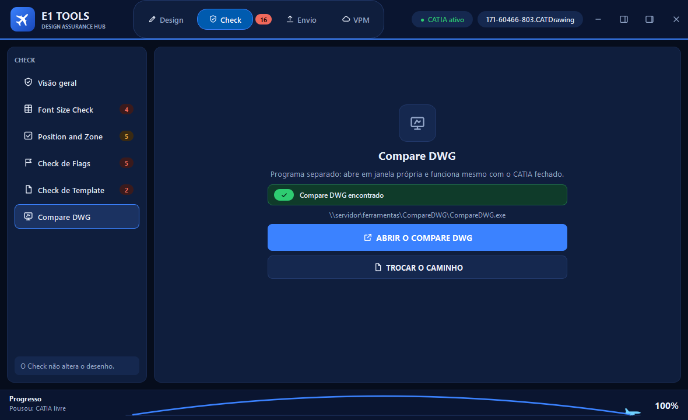

**Passo a passo:**

1. Na primeira vez, clique em **ADICIONAR O CAMINHO DO COMPARE DWG** e escolha o programa (.exe, .bat,
   .cmd, atalho .lnk ou .py).
2. Depois, **ABRIR O COMPARE DWG** abre direto.
3. **TROCAR O CAMINHO** escolhe outro programa.

O caminho fica guardado em `%APPDATA%\E1DWGTools\config.json`, fora da pasta do HUB, e não se perde ao
atualizar o programa. Se o programa mudar de lugar, a tela mostra "Programa não encontrado nesse
caminho" e o botão vira **ESCOLHER O CAMINHO DE NOVO**.

---

## 5. Aba Envio: Splits

Os Splits **criam arquivos novos**. O documento aberto não é dividido. Os dois mostram o tamanho de cada
arquivo gerado comparado com o limite de envio de **200 MB**.

### 5.1 Split 3D

**Para que serve:** divide os Bodies de um CATPart em várias peças menores.

**Quando usar:** peça grande demais para enviar inteira.

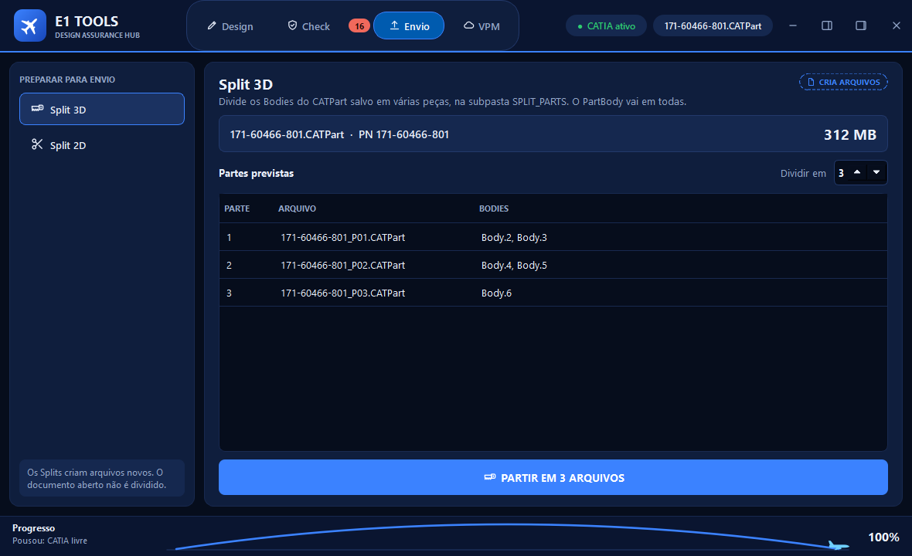

**Passo a passo:**

1. Abra o CATPart no CATIA. Ele precisa estar **salvo** em disco.
2. Em **Envio › Split 3D**, confira o arquivo, o PN e o tamanho.
3. Em **Dividir em**, escolha o número de partes. A tabela mostra quais Bodies vão em cada arquivo.
4. Clique em **PARTIR EM N ARQUIVOS**. **PARAR** termina a parte atual e para.
5. Confira os tamanhos no resultado. **ABRIR A PASTA** abre a pasta dos arquivos.

**O que é criado:**

- uma subpasta `SPLIT_PARTS` ao lado do CATPart;
- um arquivo por parte, com o nome do arquivo original e `_P01`, `_P02`…;
- os Bodies (menos o PartBody) são repartidos em sequência entre as partes; o **PartBody vai em todas**.


**Avisos:**

| Aviso | Significado |
|---|---|
| Abra um CATPart. | O documento ativo não é uma peça. |
| Salve o CATPart antes de executar. | A peça nunca foi salva em disco. |
| Nenhum Body encontrado. / NENHUM BODY PARA DIVIDIR | A peça só tem o PartBody. |
| Acima de 200 MB (no resultado) | Esse arquivo ainda passa do limite de envio. Divida em mais partes. |

Depois de um erro ("Erro ao executar o SPLIT 3D"), a peça incompleta não fica aberta, e os alertas e a
tela do CATIA voltam ao normal.

### 5.2 Split 2D

**Para que serve:** exporta cada folha do desenho para um CATDrawing próprio.

**Quando usar:** desenho com muitas folhas que precisa ser enviado em partes.

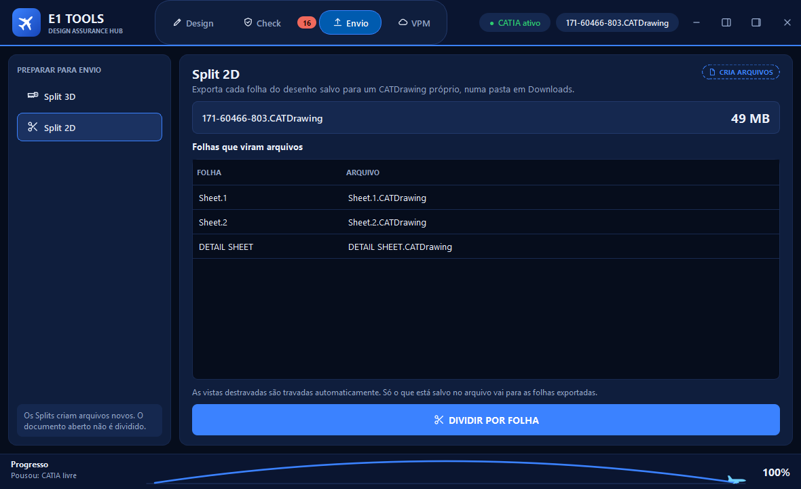

**Passo a passo:**

1. Abra o desenho. Ele precisa ter sido **salvo** em disco: o Split 2D copia o arquivo do disco.
   **Alterações não salvas não vão para os arquivos exportados.**
2. Em **Envio › Split 2D**, confira o arquivo, o tamanho e a lista "Folhas que viram arquivos".
3. Clique em **DIVIDIR POR FOLHA**. **PARAR** termina a folha atual e para.
4. Confira o resultado. **ABRIR A PASTA** abre a pasta.

**O que é criado e o que muda:**

- uma pasta com o PN do desenho dentro de **Downloads** (por exemplo `Downloads\171-60466-803\`);
- um arquivo por folha, com o nome da folha;
- um arquivo com o mesmo nome que já existir nessa pasta é **substituído**;
- todas as vistas destravadas são **travadas**, no desenho aberto e em cada arquivo exportado. A tela
  avisa quantas: "N vista(s) foram bloqueadas automaticamente". No desenho aberto, a trava só fica se
  você salvar.

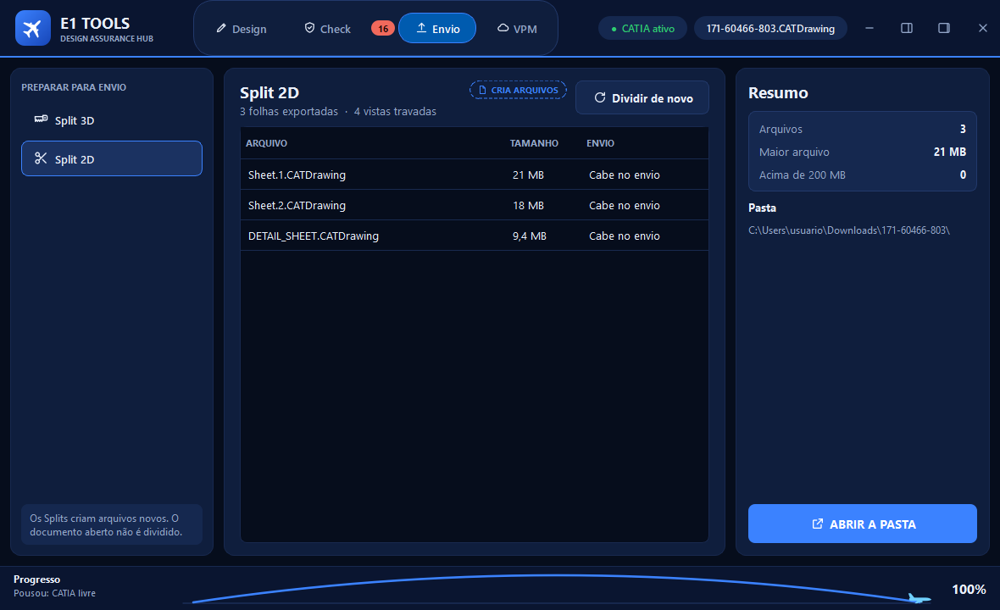

**Avisos:** "Abra um CATDrawing antes de executar.", "Salve o CATDrawing antes de executar a macro." e,
no resultado, "Acima de 200 MB" para o arquivo que ainda passa do limite. Depois de um erro, a cópia
incompleta não fica aberta.

---

## 6. Aba VPM

A aba VPM cria PNs e atualiza o conteúdo de PNs no **VPM web**, pelo **Microsoft Edge**. É o porte da
macro "VPM Tools unificado".

> **Atenção:** nada desta aba foi testado no VPM de verdade, porque o VPM só abre na rede da empresa.
> As telas abaixo mostram a prévia com dados de exemplo. Criação e Upload **alteram o VPM e não podem
> ser desfeitos pelo HUB**.

### 6.1 O que as três telas têm em comum

- **Primeiro a prévia, depois a execução.** **VALIDAR E MONTAR PRÉVIA** lê o Excel e a pasta, confere
  tudo e monta a tabela, sem abrir o VPM ("Prévia validada: N PNs. Nada foi enviado ao VPM.").
  **EXECUTAR PLANO** só fica disponível depois disso. Mudar o Excel, a pasta, os tipos ou o ambiente
  apaga a prévia.
- **Confirmação antes de começar**, com o número de PNs e os cuidados. O botão padrão é **Não**.
- **O lote para no primeiro erro.** As linhas seguintes ficam "NAO_EXECUTADO".
- **Login:** o Edge abre com o mesmo perfil da macro antiga, então o login já feito continua valendo. Se
  pedir login, faça no Edge; o HUB espera até 3 minutos.
- **Um lote por vez**, entre as três telas. Depois do lote, o Edge **fica aberto para você revisar**.
  Clique em **Encerrar sessão** antes de começar outro lote.
- **Interromper** pede a parada: a operação atual termina, e o que já foi enviado não é desfeito.
- **"PICS not connected"** interrompe o lote e mostra um aviso "PICS / interoperabilidade".
- **Históricos:** o que já foi criado ou enviado (pela macro antiga ou pelo HUB) fica registrado e não é
  repetido. Os históricos ficam em `%LOCALAPPDATA%\VPMTools`, os mesmos da macro.
- **Abrir pasta de resultados** abre essa pasta, com o relatório de cada lote.
- O HUB não fecha com um lote rodando.

**Status de cada PN na tabela:**

| Status | Significado |
|---|---|
| PENDENTE | Ainda não rodou. |
| EM_EXECUCAO | Rodando agora. |
| CONFIRMADO | PN criado e achado no VPM depois do Create. |
| CONFIRMADO_HISTORICO_LOCAL | Já tinha sido criado antes (histórico local). Não foi criado de novo. |
| VALIDADO_SEM_CRIAR | Modo "só preencher e conferir": formulário conferido e cancelado. |
| CONFIRMADO_PELO_USUARIO_OU_HISTORICO | Conteúdo enviado e confirmado por você, ou já confirmado antes. |
| IGNORADO_HISTORICO_LOCAL | Esse mesmo arquivo já tinha sido enviado e confirmado. Não foi enviado de novo. |
| NAO_SOLICITADA / NAO_SOLICITADO | A tela não pediu essa etapa. |
| NAO_EXECUTADO | Não rodou porque o lote parou antes. |
| ERRO_ANTES_CREATE / ERRO_ANTES_UPLOAD | Deu erro antes de enviar. Nada foi enviado nessa etapa. |
| **CRIACAO_INCERTA** | O Create foi enviado e algo falhou depois. **O PN pode ter sido criado.** Confira no VPM antes de repetir. |
| **UPLOAD_INCERTO** | O Upload foi acionado e não foi confirmado. Confira no VPM antes de repetir. |
| **REVISAO_NECESSARIA** | Um lote anterior deixou a criação incerta. O HUB não repete: confira no VPM. |

Verde: concluído. Amarelo: em andamento ou não executado. Vermelho: erro ou incerto.

### 6.2 Criar PNs

**Para que serve:** cria PNs novos no VPM por **Duplicate** de um PN de origem, preenchendo e conferindo
os atributos de cada linha do Excel.

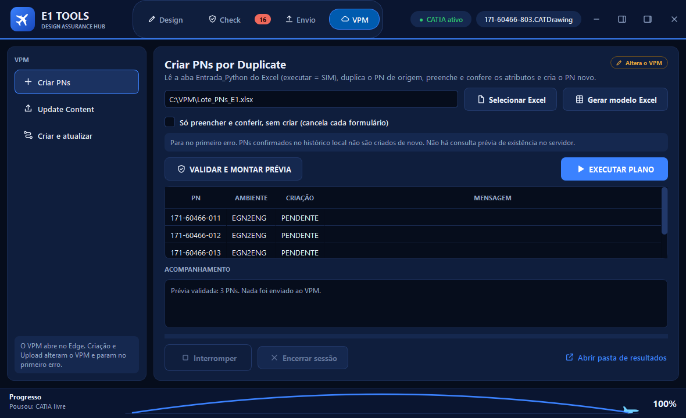

**O Excel de entrada:**

- aba **Entrada_Python**, com a primeira linha de cabeçalho;
- só rodam as linhas com **executar = SIM**;
- colunas obrigatórias: `executar`, `pn_origem`, `ambiente`, `part_number`, `part_instance`,
  `conc_version`, `conf_type`, `english_description`, `portuguese_description`, `type`, `origin`,
  `production`, `design`, `calculated_weight_g`, `ata_code`, `dbt_code`, `drawing_class`, `class`,
  `status`, `cpl`, `type_program`, `traceability`;
- **Gerar modelo Excel** salva um modelo vazio, com as listas suspensas. Na primeira vez, se o modelo
  ainda não estiver no PC, o HUB pede o arquivo `.py` da macro antiga do VPM, tira o modelo de dentro
  dele (sem executar a macro) e guarda para as próximas vezes.

**A prévia recusa o lote** (e lista tudo o que precisa corrigir) quando: falta coluna ou ela está
repetida, campo obrigatório vazio, PN novo igual ao de origem, PN repetido no lote, peso que não é
número (use ponto decimal) ou Conc. Version que não é inteiro positivo.

**Passo a passo:**

1. **Selecionar Excel**.
2. Se quiser só testar, marque **Só preencher e conferir, sem criar**: o HUB preenche e confere cada
   formulário e **cancela**, sem criar nada.
3. **VALIDAR E MONTAR PRÉVIA** e confira a tabela.
4. **EXECUTAR PLANO** e confirme.
5. Para cada PN, o HUB: abre o VPM, escolhe o ambiente, pesquisa o PN de origem, faz Edit › Duplicate,
   preenche os campos, **lê cada campo de volta** e só então clica em Create, **uma vez só**. Depois
   pesquisa o PN novo para confirmar.

Se uma opção do Excel não existir na lista do VPM, o lote para com "Opção inválida em (campo)", listando
as opções disponíveis. Não há consulta prévia completa de existência do PN no servidor: o controle é o
histórico local.

### 6.3 Update Content

**Para que serve:** atualiza o conteúdo (Edit › Update Content) de PNs que **já existem** no VPM, com os
arquivos CATIA de uma pasta. O PN sai do nome do arquivo.

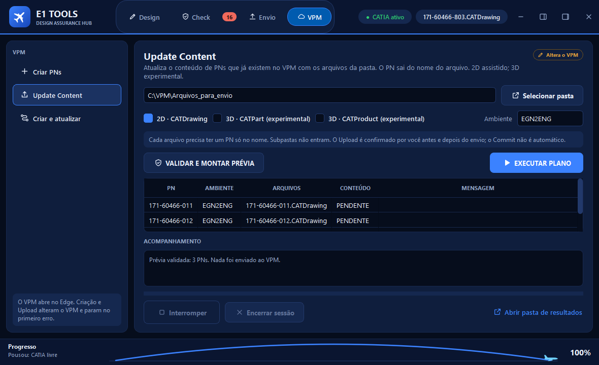

**Os arquivos:**

- só a pasta escolhida; subpastas não entram;
- cada nome de arquivo precisa ter **um PN só** (por exemplo `171-52382-001.CATDrawing`,
  `SPD171-52382-001…`). Nome sem PN, ou com dois, recusa a prévia;
- dois arquivos do mesmo PN e tipo recusam a prévia;
- tipos: **2D · CATDrawing** (assistido) e **3D · CATPart / CATProduct (experimental)**. No 3D, o
  documento DOCCAD do tipo certo precisa já existir no VPM; o HUB não cria documentos nem importa
  dependências;
- **Ambiente**: padrão `EGN2ENG`. Só letras maiúsculas, números e sublinhado.

**Passo a passo:**

1. **Selecionar pasta**, marque os tipos e confira o ambiente.
2. **VALIDAR E MONTAR PRÉVIA**. A prévia guarda uma assinatura de cada arquivo: se um arquivo mudar depois
   da prévia, o lote para ("Arquivo alterado desde a prévia").
3. **EXECUTAR PLANO** e confirme. O CATIA precisa estar aberto: o HUB usa o CATIA que já está aberto.
4. Para cada arquivo, o HUB abre (ou usa) o documento no CATIA, que precisa estar **salvo**; pesquisa o
   PN no VPM, abre o documento na árvore e entra em Edit › Update Content, Source = CATIA V5.
5. O HUB confere o destino (PN, documento e tipo) e desmarca "Save as New Document". Uma janela pede a
   sua confirmação: **confira no CATIA o documento e o destino** antes de clicar em Sim.
6. O HUB clica em **Upload uma vez só**. Outra janela pede para você conferir o resultado no VPM.
   **Clique Sim só se a atualização terminou certo.** Não interrompe o lote como resultado incerto.
7. **O Commit não é automático.** Se o VPM exigir Commit, faça à mão.

Se o HUB não achar o documento na árvore ou o menu Update Content, ele grava um arquivo de diagnóstico e
pede que você abra o menu à mão (só Edit › Update Content, parando na janela Source = CATIA V5) antes de
clicar em Sim. Nesses casos nenhum Upload é enviado sem a sua confirmação.

**O Upload é bloqueado** se o documento ativo no CATIA mudar, se o documento for alterado depois da
conferência, se o destino mudar ou se "Save as New Document" estiver marcado.

### 6.4 Criar e atualizar

**Para que serve:** para cada PN do Excel, cria o PN e logo em seguida faz o Update Content dos arquivos
dele, antes de passar ao próximo.

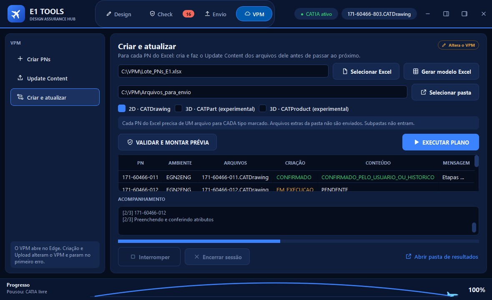

**Passo a passo:**

1. **Selecionar Excel** (o mesmo formato do Criar PNs) e **Selecionar pasta** (as mesmas regras do
   Update Content).
2. Marque os tipos. **Cada PN do Excel precisa de um arquivo para cada tipo marcado.** Faltando um, a
   prévia recusa: "Arquivo ausente: (PN) / (tipo)". Arquivos extras da pasta não são enviados.
3. **VALIDAR E MONTAR PRÉVIA**, **EXECUTAR PLANO** e confirme.
4. Siga as confirmações de cada Upload como no [Update Content](#63-update-content).

O ambiente de cada PN vem da coluna `ambiente` do Excel.

---

## 7. Instalação e atualização

O programa fica numa pasta (por exemplo `E1DWGTOOLS`). Precisa de Python 3.10 ou mais novo.

### Conferir a instalação

Na pasta do programa, rode:

```bash
python verificar.py
```

O verificador não mexe no CATIA nem nos desenhos e pode rodar quantas vezes precisar. Ele:

1. confere a versão do Python;
2. confere **cada arquivo** do programa (número de linhas e conteúdo) e, para o que estiver errado, diz
   o que fazer e dá o link do GitHub de onde copiar;
3. confere as bibliotecas do HUB (pywin32 e PySide6) e instala o que faltar;
4. abre a janela do HUB escondida para testar;
5. confere as bibliotecas da aba VPM (openpyxl e playwright). Faltando, só a aba VPM fica sem funcionar:
   é aviso, não erro;
6. informa se o CATIA está aberto e se o Excel está instalado.

No fim aparece **TUDO CERTO. Para abrir, rode: python main_qt.py** ou **AINDA NÃO ESTÁ PRONTO**. Nesse
caso, resolva os itens `[ERRO]` e rode de novo.

| Mensagem do verificador | O que fazer |
|---|---|
| arquivo: não existe. Crie e cole de: (link) | Crie o arquivo nesse caminho e cole o conteúdo do link. |
| arquivo: está em (outra pasta). Mova para a pasta certa. | O arquivo foi salvo no lugar errado. |
| arquivo: tem N linhas e devia ter M. Cole de novo de: (link) | A cópia veio incompleta. Copie de novo. |
| arquivo: o conteúdo está diferente. Cole de novo de: (link) | A cópia veio diferente. Copie de novo. |
| arquivo: salvo na codificação errada. Salve como UTF-8. | Salve de novo, escolhendo UTF-8. |
| Peça à TI para liberar pypi.org e files.pythonhosted.org… | A rede bloqueou a instalação das bibliotecas. |
| Peça à TI para instalar o Microsoft Visual C++ Redistributable. | Uma biblioteca precisa desse componente do Windows. |
| CATIA fechado. O HUB abre, mas as ferramentas precisam dele aberto. | Só um aviso. |
| Excel não encontrado… | O Position and Zone precisa do Excel para ler o Part List. |

### Atualizar o programa

Para atualizar no PC da empresa, copie arquivo por arquivo dos links do GitHub (branch
`migracao-dwgtools`) e rode `python verificar.py` no fim: ele aponta qualquer arquivo que ficou faltando
ou diferente. O caminho do Compare DWG, o OK manual do Position and Zone e os históricos do VPM ficam
fora da pasta do programa e não se perdem na atualização.

### Quando as macros do CATIA travam

Se as macros do CATIA pararem de responder depois de usar o HUB (mesmo com ele fechado), rode:

```bash
python verificar.py --catia
```

Ele mostra o estado do CATIA (interação, alertas e tela ligados ou não, documentos e janelas abertos,
documento ativo, itens selecionados e quantos Python, CATIA e Excel estão rodando), tira a seleção e
religa alertas, tela e interação. **O desenho não muda.** Depois, clique na macro e, se não voltar,
mande uma foto da tela.

A causa desse travamento ainda não foi encontrada: não se repetiu nos testes.

---

## 8. Arquivos de diagnóstico e onde ficam

`%APPDATA%` e `%LOCALAPPDATA%` são pastas do seu usuário no Windows. Para abrir, digite o nome (com os
`%`) na barra de endereço do Explorer.

**Em `%APPDATA%\E1DWGTools\`:**

| Arquivo | Gravado por | Conteúdo |
|---|---|---|
| `config.json` | Compare DWG | Caminho do programa Compare DWG. |
| `poszone_ok.json` | Position and Zone | OK manual de cada posição, por desenho. Apagar zera todos os OK manuais deste PC. |
| `poszone_grade.txt` | Position and Zone, a cada mapeamento | De onde veio a grade de cada folha, posição das colunas e linhas, comparação com a grade desenhada, posição e zona de cada balão. Use quando uma zona parecer errada. |
| `update_vinculos.txt` | Update Template, a cada conversão | O que cada campo da legenda achou e recriou, e os textos da folha 1 depois da conversão. |
| `update_tempos.txt` | Update Template | Quanto cada fase da última conversão levou. Não aparece na tela. |
| `templates_lidos.json` | Update Template | Leitura guardada de cada template, para acelerar. Vale enquanto o arquivo do template tiver o mesmo tamanho e data. Pode ser apagado: é refeito na próxima conversão. |

**Em `%LOCALAPPDATA%\VPMTools\`** (a mesma pasta da macro antiga):

| Arquivo | Conteúdo |
|---|---|
| `historico_criacao_vpm.json` | PNs criados (ou com criação iniciada). **Não apague sem revisar o que já foi enviado.** |
| `historico_upload_unificado.json` | Arquivos enviados por Update Content. **Não apague sem revisar.** |
| `sequencia_vpm_(data e hora).json` | Relatório de cada lote, com o status de cada PN. |
| `erro_unificado.txt` | Detalhe do último erro de lote. |
| `diagnostico_vpm.json`, `diagnostico_arvore_vpm.json`, `diagnostico_menu_vpm.json` | O que o HUB achou na página do VPM quando não conseguiu identificar o formulário, a árvore ou o menu. |
| `resultado_criacao_vpm.json` | A linha do VPM encontrada depois do último Create. |
| `perfil_edge_vpm\` | Perfil do Edge que guarda o login do VPM. |
| `vpm_modelo.xlsx` | Modelo do Excel tirado da macro antiga. |

**Outros lugares:**

- **ABRIR NO EXCEL** do Position and Zone grava a planilha na pasta temporária do Windows (`%TEMP%`), a
  partir do modelo `_Callouts.xlsm` da rede, e deixa aberta no Excel.
- **Split 2D:** `Downloads\(PN)\`. **Split 3D:** `SPLIT_PARTS\`, ao lado do CATPart.

---

## 9. Problemas comuns

| Problema | O que fazer |
|---|---|
| O HUB diz "CATIA fechado" com o CATIA aberto | Espere alguns segundos ou clique em PROCURAR DE NOVO. Se continuar, feche e abra o HUB. |
| A ferramenta não libera com o desenho aberto | Confira o chip com o nome do documento no alto. Clique na janela do desenho no CATIA para ele ficar ativo. |
| "Item não encontrado: foi apagado ou o desenho foi fechado" | O item mudou depois da análise. Rode a ferramenta de novo. Renomear um item depois da análise também causa isso. |
| O Update Template deu erro no meio | Leia a mensagem. Se disser que o desenho pode ter ficado parcialmente convertido, feche **sem salvar** e abra de novo. |
| Zona errada no Position and Zone | Abra o `poszone_grade.txt` e veja de onde saiu a grade da folha. Se o mapeamento avisou "caminho de reserva", confira um balão de cada folha citada. |
| Callout com zona N/A | O CATIA não informou a posição da vista ou do texto, ou a folha não tem grade. O aviso do fim do mapeamento diz qual. |
| "As abas 'COMPONENT' e 'PSA' não foram encontradas" | O arquivo escolhido não é o Part List do SAP. |
| Check de Flags não compara com o Part List | O arquivo não tem a aba DWG_NOTES com a coluna Note Code. |
| Macros do CATIA travadas | `python verificar.py --catia`, veja a [seção 7](#quando-as-macros-do-catia-travam). |
| Lote do VPM com status INCERTO | Confira o PN no VPM antes de repetir. O HUB não repete sozinho uma criação ou Upload incerto. |
